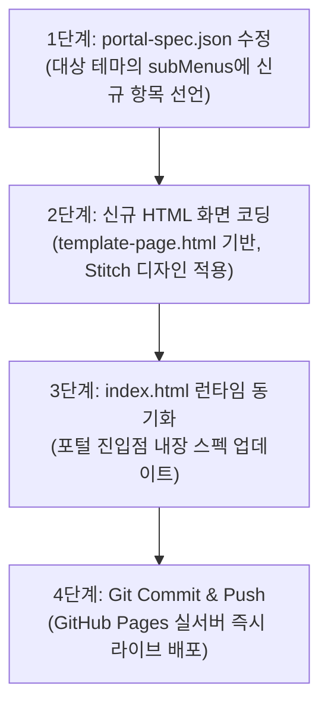

# Clinical Ledger Precision — AI 프롬프트 연동 메뉴 관리 가이드라인 (PORTAL_RULES.md)

이 문서는 AI 어시스턴트(프롬프트 에이전트) 및 개발자가 포털의 **테마, 대시보드, 하위메뉴를 일관성 있게 생성, 수정, 삭제, 관리**하기 위한 마스터 엔지니어링 가이드라인입니다.

---

## 🏛️ 1. 단일 진실 원천 (Single Source of Truth, SSOT)

포털의 전체 네비게이션 구조는 단 하나의 명세 파일인 **[`portal-spec.json`](portal-spec.json)** 에 의해 통제됩니다.

* **테마 추가/수정/삭제**: `portal-spec.json`의 `themes` 배열 항목 제어
* **하위메뉴 추가/수정/삭제**: 해당 테마의 `subMenus` 배열 항목 제어
* **권한 제어(RBAC)**: `role: "all"` 또는 `role: "admin"` 설정

---

## 🎨 2. Stitch 디자인 시스템 엄격 준수 규칙 ([DESIGN.md](DESIGN.md))

AI가 신규 화면(HTML)을 생성하거나 메뉴를 수정할 때 아래 토큰을 100% 일관되게 적용해야 합니다:

| 항목 | 토큰 / 값 | 용도 |
| :--- | :--- | :--- |
| **Primary** | `#00236f` (Deep Cobalt) | 주요 브랜드 타이틀, 액션 버튼, 헤더 GNB |
| **Primary Container** | `#1e3a8a` (Navy) | 활성 메뉴 탭, 헤더 배지, 강조 패널 |
| **Surface** | `#faf8ff` (Canvas) | 전역 배경색, 폼 인풋 배경 |
| **Surface Container** | `#f2f3ff` ~ `#eaedff` | 테마 카드, 헤더 하이라이트 박스 |
| **Borders** | `#cbd5e1` / `#e2e8f0` | 카드 테두리, 테이블 헤어라인 구분선 |
| **Headline Font** | `'Plus Jakarta Sans', sans-serif` | 화면 제목, 대시보드 타이틀 (600/700) |
| **Body Font** | `'Noto Sans KR', sans-serif` | 본문, 설명, 메뉴 라벨 (13px 기본) |
| **Numeric Font** | `'JetBrains Mono', monospace` | 금액, 수치, 코드 (`font-variant-numeric: tabular-nums`) |

### 시맨틱 상태 배지 컬러 규격:
* 완결/승인: `bg-[#ecfdf5] text-[#059669] border-[#a7f3d0]` (`badgeColor: "green"`)
* 수정/조정: `bg-[#fffbeb] text-[#d97706] border-[#fde68a]` (`badgeColor: "amber"`)
* 신규/안내: `bg-[#eff6ff] text-[#2563eb] border-[#bfdbfe]` (`badgeColor: "blue"`)
* 경고/미결: `bg-[#fef2f2] text-[#dc2626] border-[#fecaca]` (`badgeColor: "red"`)

---

## 🔄 3. 프롬프트 기반 메뉴 관리 표준 절차 (AI Agent SOP)

사용자가 채팅창에서 자연어로 메뉴 생성을 요청했을 때, AI 에이전트는 다음 4단계를 순차적으로 수행합니다:



### [단계 1] `portal-spec.json` 스펙 등록
```json
{
  "id": "drug-return-audit",
  "title": "의약품 반품 정산 대사",
  "type": "iframe",
  "url": "drug-return.html",
  "badge": "신규업무",
  "badgeColor": "blue",
  "role": "all",
  "description": "병원별 의약품 반품 승인 및 차감 정산 내역 대사"
}
```

### [단계 2] 신규 HTML 페이지 코딩 (`template-page.html` 활용)
* 상대 경로 무결성을 위해 신규 HTML 파일은 프로젝트 루트(`/`)에 생성합니다.
* 반드시 [DESIGN.md](DESIGN.md)의 Tailwind 색상 클래스와 폰트(`Plus Jakarta Sans`, `Noto Sans KR`, `JetBrains Mono tabular-nums`)를 적용합니다.

### [단계 3] 배포 자동화
* 변경된 파일들을 Git에 커밋하고 `origin main`으로 푸시하여 `https://chuanlgg-source.github.io/changhwan/`에 즉시 반영합니다.

---

## 💬 4. 프롬프트 요청 예시 모음 (User Prompts)

다음과 같이 자연어로 요청하시면 AI가 즉시 규칙에 맞춰 일관성 있게 작업을 완결합니다:

1. **신규 메뉴 추가 요청**:
   > *"병원부 정산 테마 하위에 '의약품 반품 정산' 메뉴를 추가하고 샘플 테이블이 있는 HTML 페이지를 연결해줘."*
2. **기존 메뉴 수정 요청**:
   > *"'월별 미결 차액 소명 관리' 메뉴 이름을 '차액 정밀 소명 관리'로 바꾸고 배지를 '중요'로 변경해줘."*
3. **메뉴 삭제 요청**:
   > *"'신규 메뉴 확장 샘플' 테마에서 템플릿 미리보기 메뉴를 제거해줘."*
4. **접근 권한 변경 요청**:
   > *"'월별 미결 차액 소명 관리' 메뉴를 내부관리자(Admin) 전용 메뉴로 변경해줘."*
